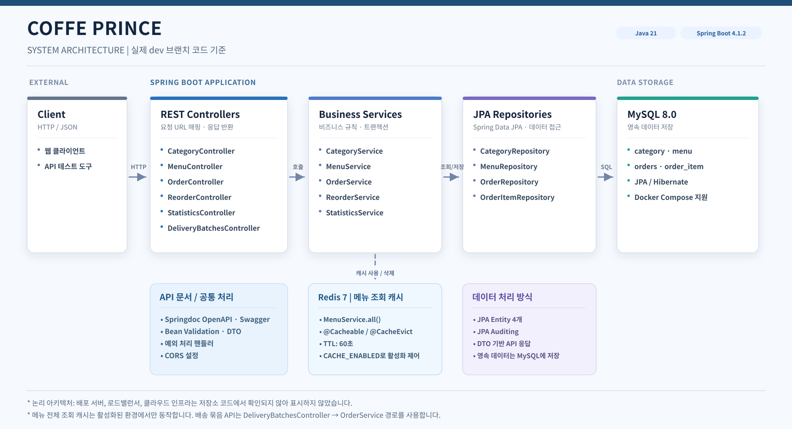
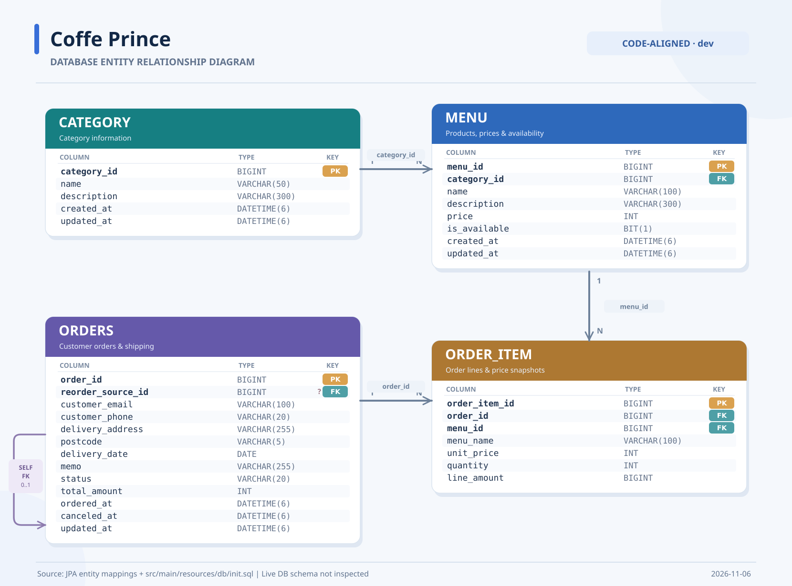

# ☕ 커피프린스 4호점

> 원두 상품의 카테고리·메뉴 관리부터 주문 접수, 재주문, 배송일별 주문 묶음 조회까지 제공하는 **Spring Boot 기반 REST API 프로젝트**

## 📌 프로젝트 소개

**커피프린스 4호점**은 원두 상품을 관리하고 고객의 주문을 처리하는 백엔드 서비스입니다. 카테고리와 메뉴를 관리하고, 고객별 주문 내역 조회·취소·재주문 및 날짜별 통계 조회 기능을 제공합니다.

MySQL에 주문과 상품 데이터를 저장하며, 반복적으로 요청되는 전체 메뉴 목록에는 Redis 캐시를 적용했습니다.

## ✨ 주요 기능

| 구분 | 주요 기능 |
|---|---|
| 카테고리 | 목록·상세 조회, 등록, 수정, 삭제, 카테고리별 메뉴 조회 |
| 메뉴 | 등록·조회·수정·삭제, 이름 검색, 판매 가능 메뉴 조회, 판매 여부 변경 |
| 주문 | 주문 접수·조회·취소, 메모 수정, 기존 주문 기반 재주문 |
| 배송 | 배송일 기준 주문을 고객별로 묶어 조회 |
| 통계 | 날짜별 주문·메뉴·고객 통계 조회 |
| 공통 기능 | API 입력 검증 및 오류 응답, Swagger UI, Redis 메뉴 목록 캐시 |
| 선택 심화 | RestClient를 통한 외부 게시글 조회 및 실패 응답 처리 |

## 🛠 기술 스택

| 구분 | 기술 |
|---|---|
| Language | Java 21 |
| Framework | Spring Boot 4.1.2, Spring Web MVC |
| Persistence | Spring Data JPA, Hibernate |
| Database | MySQL 8.0 |
| Cache | Redis 7, Spring Cache |
| API Documentation | Springdoc OpenAPI 3.2.0, Swagger UI |
| Build | Gradle |
| Test | JUnit Platform, Spring Boot Test, MockMvc |
| Local Infrastructure | Docker Compose |

## 🏗 시스템 아키텍처



## 🗃 데이터베이스 ERD



카테고리(`category`), 메뉴(`menu`), 주문(`orders`), 주문 항목(`order_item`)을 중심으로 데이터를 관리합니다. 자세한 설계 내용은 [ERD 문서](./docs/ERD.md)를 참고해 주세요.

> ERD 문서는 설계 참고 자료입니다. 최종 테이블 구조는 JPA 엔티티와 [`db/init.sql`](./src/main/resources/db/init.sql)을 함께 확인해 주세요.

## 📡 API 명세

**기본 주소:** `http://localhost:8080/api/v1`  
**Swagger UI:** [http://localhost:8080/swagger-ui/index.html](http://localhost:8080/swagger-ui/index.html) (로컬 서버 실행 후 접속)

아래 엔드포인트는 모두 `/api/v1`을 기준으로 합니다.

| 구분 | Method | Endpoint | 기능 |
|---|---|---|---|
| 카테고리 | GET | `/categories` | 카테고리 목록 조회 |
| 카테고리 | GET | `/categories/{categoryId}` | 카테고리 상세 조회 |
| 카테고리 | POST | `/categories` | 카테고리 등록 |
| 카테고리 | PUT | `/categories/{categoryId}` | 카테고리 수정 |
| 카테고리 | DELETE | `/categories/{categoryId}` | 카테고리 삭제 |
| 카테고리 | GET | `/categories/{categoryId}/menus` | 카테고리별 메뉴 조회 |
| 메뉴 | GET | `/menus` | 전체 메뉴 조회 |
| 메뉴 | GET | `/menus/{menuId}` | 메뉴 상세 조회 |
| 메뉴 | GET | `/menus/available` | 판매 가능 메뉴 조회 |
| 메뉴 | GET | `/menus/search?keyword={keyword}` | 메뉴명 검색 |
| 메뉴 | POST | `/menus` | 메뉴 등록 |
| 메뉴 | PUT | `/menus/{menuId}` | 메뉴 수정 |
| 메뉴 | PUT | `/menus/{menuId}/availability` | 메뉴 판매 여부 변경 |
| 메뉴 | DELETE | `/menus/{menuId}` | 메뉴 삭제 |
| 주문 | POST | `/orders` | 주문 접수 |
| 주문 | GET | `/orders?email={email}` | 이메일별 주문 목록 조회 |
| 주문 | GET | `/orders/{orderId}` | 주문 상세 조회 |
| 주문 | PUT | `/orders/{orderId}/memo` | 주문 메모 수정 |
| 주문 | POST | `/orders/{orderId}/cancel` | 주문 취소 |
| 주문 | POST | `/orders/{orderId}/reorder` | 기존 주문 기반 재주문 |
| 배송 | GET | `/delivery-batches?shippingDate={date}` | 배송일별 주문 묶음 조회 |
| 통계 | GET | `/statistics/orders?date={date}` | 주문 통계 |
| 통계 | GET | `/statistics/menus?date={date}` | 메뉴 통계 |
| 통계 | GET | `/statistics/customers?date={date}` | 고객 통계 |
| 선택 심화 | GET | `/reference/posts/{postId}` | 외부 게시글 조회 |
| 선택 심화 | GET | `/menus/page?page={page}&size={size}` | 전체 메뉴 페이지별 조회 |

### 대표 요청 예시: 메뉴 등록

```http
POST /api/v1/menus
Content-Type: application/json

{
  "categoryId": 1,
  "name": "House Blend",
  "price": 6000,
  "description": "블렌드 원두 패키지입니다."
}
```

등록 성공 시 `201 Created`와 생성된 메뉴 정보를 반환합니다. 구체적인 요청·응답 구조는 Swagger UI에서 확인할 수 있으며, 로컬 HTTP 요청 예시는 [`requests/api-check.http`](./requests/api-check.http)에 정리되어 있습니다.

## ⚙️ 핵심 구현 방식 및 설계 포인트

### 1. Redis 기반 메뉴 목록 캐시

전체 메뉴 목록(`GET /api/v1/menus`)에 Spring Cache와 Redis를 적용했습니다.

- `@Cacheable`로 조회 결과를 `menus::all`에 캐싱하고 TTL을 **60초**로 설정했습니다.
- 메뉴 등록·수정·삭제·판매 여부 변경 시 `@CacheEvict`로 캐시를 무효화합니다.
- 로컬 설정에서 `CACHE_ENABLED=false`로 캐시를 끌 수 있습니다.

반복 조회에 따른 DB 접근을 줄이면서 메뉴 변경 사항을 다시 반영하도록 설계했습니다. **실제 성능 향상 수치는 별도 측정하지 않았습니다.**

관련 코드: [RedisCacheConfig.java](./src/main/java/com/kdt/coffeprince/config/RedisCacheConfig.java), [MenuService.java](./src/main/java/com/kdt/coffeprince/service/MenuService.java)

### 2. 주문과 주문 항목의 트랜잭션 처리

주문 접수와 재주문에는 `@Transactional`을 적용했습니다. 주문(`Order`)과 주문 항목(`OrderItem`)은 JPA 연관관계 및 `CascadeType.ALL`을 이용해 함께 저장합니다.

주문 접수·재주문은 공통 `createOrder()` 로직에서 메뉴 판매 가능 여부, 배송지 조건 등을 검사하고 주문 데이터를 생성합니다. **관련 데이터가 일부만 저장되는 상황을 방지**하기 위한 구조입니다.

관련 코드: [OrderService.java](./src/main/java/com/kdt/coffeprince/service/OrderService.java), [Order.java](./src/main/java/com/kdt/coffeprince/entity/Order.java)

#### 시각 경계값 확인 방법 (13:59:59 / 14:00:00)

PC·서버 시계를 바꾸지 않고 확인합니다. 운영 코드는 `Clock` 빈(`ClockConfig`)으로 "지금 시각"을 읽고, 접수 시각을 한 번 읽어 배송일 계산과 `createdAt` 저장에 그대로 사용합니다. 테스트에서는 `TestClockConfig`가 `MutableClock`을 `@Primary`로 바꿔 끼워 `clock.set(년, 월, 일, 시, 분, 초)`로 서울 시각을 고정합니다.

- [`OrderBusinessRuleTest`](./src/test/java/com/kdt/coffeprince/rule/OrderBusinessRuleTest.java): 실제 MySQL에 주문을 넣어 13:59:59 → 당일, 14:00:00·14:00:01 → 다음 날, 12월 31일 → 다음 해 배송일과 취소 마감·재취소·재주문을 검증합니다. 고정한 접수 시각이 응답 `createdAt`과 배송일에 함께 반영되는지도 확인합니다. `db/init.sql`의 메뉴 1번을 사용하고 클래스 전체가 `@Transactional`이라 데이터는 남지 않습니다.
- [`OrderCancelDeadlineTest`](./src/test/java/com/kdt/coffeprince/entity/OrderCancelDeadlineTest.java): DB 없이 `Order.isCancellableAt(Instant)`에 13:59:59와 14:00:00을 직접 넣어 취소 마감을 확인합니다.

### 3. 주문 당시 메뉴 정보 보존

`OrderItem` 생성 시점의 **메뉴명·단가·수량·금액**을 별도 필드에 저장합니다. 이후 메뉴 가격이나 이름이 변경되어도 기존 주문에 기록된 값은 유지됩니다.

또한 주문 항목에서 참조 중인 메뉴는 `MENU_IN_USE` 비즈니스 예외로 삭제를 차단하여 주문 이력과의 관계를 보호하도록 구성했습니다.

관련 코드: [OrderItem.java](./src/main/java/com/kdt/coffeprince/entity/OrderItem.java), [MenuService.java](./src/main/java/com/kdt/coffeprince/service/MenuService.java)

### 4. 배송일 및 주문 취소 업무 규칙

- **주문 접수:** 서울 시간 기준 14:00 이전 접수는 당일 배송일, 14:00부터는 다음 날 배송일로 계산합니다.
- **주문 취소:** 저장된 배송일의 14:00 이전인 접수 상태 주문만 취소할 수 있습니다.
- **이력 보존:** 취소 시 주문 상태와 취소 시각을 변경하고, 주문 항목·금액은 그대로 둡니다.

관련 코드: [OrderService.java](./src/main/java/com/kdt/coffeprince/service/OrderService.java), [Order.java](./src/main/java/com/kdt/coffeprince/entity/Order.java)

#### 시각 경계값 확인 방법 (13:59:59 / 14:00:00)

PC·서버 시계를 바꾸지 않고 확인합니다. 운영 코드는 `Clock` 빈(`ClockConfig`)으로 "지금 시각"을 읽고, 접수 시각을 한 번 읽어 배송일 계산과 `createdAt` 저장에 그대로 사용합니다. 테스트에서는 `TestClockConfig`가 `MutableClock`을 `@Primary`로 바꿔 끼워 `clock.set(년, 월, 일, 시, 분, 초)`로 서울 시각을 고정합니다.

- [`OrderBusinessRuleTest`](./src/test/java/com/kdt/coffeprince/rule/OrderBusinessRuleTest.java): 실제 MySQL에 주문을 넣어 13:59:59 → 당일, 14:00:00·14:00:01 → 다음 날, 12월 31일 → 다음 해 배송일과 취소 마감·재취소·재주문을 검증합니다. 고정한 접수 시각이 응답 `createdAt`과 배송일에 함께 반영되는지도 확인합니다. `db/init.sql`의 메뉴 1번을 사용하고 클래스 전체가 `@Transactional`이라 데이터는 남지 않습니다.
- [`OrderCancelDeadlineTest`](./src/test/java/com/kdt/coffeprince/entity/OrderCancelDeadlineTest.java): DB 없이 `Order.isCancellableAt(Instant)`에 13:59:59와 14:00:00을 직접 넣어 취소 마감을 확인합니다.

## 🚀 로컬 실행 방법

### 사전 준비

- Java 21
- MySQL 8.0
- Redis 7 (캐시 사용 시)
- Docker Desktop / Docker Compose (컨테이너로 실행할 경우)

프로젝트 루트에서 명령어를 실행합니다. 로컬 실행에는 기본적으로 `local` 프로파일이 적용됩니다.

### 방법 A. Docker Compose로 MySQL·Redis 실행

**1.** 프로젝트 루트에 `local.env` 파일을 만들고 연결 정보를 설정합니다.

```properties
DB_URL=jdbc:mysql://localhost:3306/coffeprince
DB_USERNAME=root
DB_PASSWORD=YOUR_LOCAL_DB_PASSWORD
CACHE_ENABLED=true
```

`YOUR_LOCAL_DB_PASSWORD`는 사용할 로컬 DB 비밀번호로 변경해 주세요. `local.env`는 `.gitignore` 대상이므로 저장소에 커밋하지 않습니다.

**2.** Docker Compose에 같은 환경 변수를 공급해 MySQL과 Redis를 실행합니다.

```bash
docker compose --env-file local.env up -d mysql redis
```

> `docker-compose.yml`의 MySQL 설정에서 `MYSQL_ROOT_PASSWORD`에 `${DB_PASSWORD}`를 사용합니다. 따라서 Spring Boot가 읽는 `local.env` 외에도, 위 명령어의 `--env-file`로 **Docker Compose에도 비밀번호를 전달**해야 합니다. 기존 MySQL 볼륨이 있는 경우 비밀번호 환경 변수만 바꾼다고 DB에 저장된 비밀번호가 변경되지는 않습니다.

**3.** 애플리케이션을 실행합니다.

```bash
# macOS / Linux
./gradlew bootRun

# Windows PowerShell
.\gradlew.bat bootRun
```

### 방법 B. 기존 로컬 MySQL 사용

이미 MySQL을 실행 중이라면 다음 데이터베이스를 생성합니다.

```sql
CREATE DATABASE IF NOT EXISTS coffeprince CHARACTER SET utf8mb4 COLLATE utf8mb4_bin;
```

> 콜레이션은 `utf8mb4_bin`이어야 합니다. 카테고리명 중복 검사·메뉴명 검색·이메일 비교가 대소문자를 구분하는 명세를 DB 설정으로 맞추기 때문입니다.
> 이미 `utf8mb4_unicode_ci` 등으로 만든 DB가 있다면 아래로 전환합니다.
>
> ```sql
> ALTER DATABASE coffeprince COLLATE utf8mb4_bin;
> ALTER TABLE category   CONVERT TO CHARACTER SET utf8mb4 COLLATE utf8mb4_bin;
> ALTER TABLE menu       CONVERT TO CHARACTER SET utf8mb4 COLLATE utf8mb4_bin;
> ALTER TABLE orders     CONVERT TO CHARACTER SET utf8mb4 COLLATE utf8mb4_bin;
> ALTER TABLE order_item CONVERT TO CHARACTER SET utf8mb4 COLLATE utf8mb4_bin;
> ```

프로젝트 루트의 `local.env`에 실제 MySQL 접속 정보를 입력한 후 애플리케이션을 실행합니다.

Redis를 사용하지 않을 경우 `local.env`에 `CACHE_ENABLED=false`를 추가하거나 값을 변경해 주세요. Redis 캐시가 켜진 상태에서 Redis 서버에 연결할 수 없다면 메뉴 전체 조회 요청이 실패할 수 있습니다.

> `docker-compose.yml`은 MySQL `3306`, Redis `6379` 포트를 사용합니다. 이미 해당 포트를 사용하는 프로그램이 있다면 포트 충돌 여부를 먼저 확인해 주세요.

### 초기 데이터 및 개발 환경 설정

로컬 프로파일은 JPA의 `ddl-auto: update`를 사용하며, 시작 시 [`src/main/resources/db/init.sql`](./src/main/resources/db/init.sql)을 실행하도록 설정되어 있습니다.

이 파일은 테이블 생성문(`CREATE TABLE IF NOT EXISTS`)과 다음의 초기 데이터를 포함합니다.

| 테이블 | 초기 데이터 |
|---|---|
| `category` | `Single Origin`, `Blend` |
| `menu` | `Columbia Nariñó` (5,000원), `Brazil Serra Do Caparaó` (7,000원), `Columbia Quindío (White Wine Extended Fermentation)` (9,000원), `Ethiopia Sidamo` (11,000원) |
| `orders` | `buyer@example.com` 주문 4건 (지난 배송 1건, 내일 배송 2건 중 1건은 재주문, 취소 1건), `other@example.com` 주문 2건 (오늘·내일 배송) — 배송일·접수 시각은 적재 시점 기준 상대값 |
| `order_item` | 위 주문 6건의 주문 상세 10건 (메뉴 초기 데이터 기준 스냅샷) |

> **주의:** 초기 데이터에 `ON DUPLICATE KEY UPDATE`가 사용되므로, 로컬 애플리케이션을 재실행하면 동일한 기본 키의 카테고리·메뉴·주문·주문 상세 데이터가 스크립트 값으로 갱신될 수 있습니다 (예: 테스트 중 수정한 주문 메모·취소 상태가 초기값으로 되돌아감). 또한 로컬 프로파일을 운영 DB에 연결하면 `ddl-auto: update`가 스키마를 변경할 수 있으므로 사용하지 마세요.

HikariCP에는 초기 연결 실패 관련 설정 `initialization-fail-timeout: 30000`(ms)이 적용되어 있습니다. 이 값은 모든 DB 연결 오류가 정확히 30초에 종료된다는 의미는 아닙니다.

### 프로파일

| 프로파일 | 스키마 설정 | 초기 데이터 | DB 연결 정보 |
|---|---|---|---|
| `local` (기본) | `ddl-auto: update` | `db/init.sql` 실행 | `local.env` 또는 기본 접속값 |
| `prod` | `ddl-auto: none` | 실행하지 않음 | `prod.env` 또는 환경 변수 필수 |

설정 파일: [`application.yaml`](./src/main/resources/application.yaml), [`application-local.yaml`](./src/main/resources/application-local.yaml), [`application-prod.yaml`](./src/main/resources/application-prod.yaml)

운영 프로파일로 실행하려면 필요한 DB 환경 변수를 먼저 준비해야 합니다. 예시:

```bash
# macOS / Linux
SPRING_PROFILES_ACTIVE=prod ./gradlew bootRun
```

운영 프로파일 실행은 설정 예시이며, 실제 운영 배포가 검증되었다는 의미는 아닙니다.

### Redis 캐시 동작 확인

Redis를 실행하고 애플리케이션의 `GET /api/v1/menus`를 한 번 호출한 뒤 다음 명령어로 캐시를 확인할 수 있습니다.

```bash
docker exec coffeprince-redis redis-cli GET 'menus::all'
docker exec coffeprince-redis redis-cli TTL 'menus::all'
```

메뉴 변경 API를 호출하면 캐시가 삭제되도록 구현되어 있습니다. Redis가 필요 없다면 `local.env`에서 `CACHE_ENABLED=false`로 설정할 수 있습니다.

## 🧪 테스트 및 API 확인

```bash
# 전체 테스트
./gradlew test

# RestClient 외부 게시글 API 테스트
./gradlew test --tests "*ReferencePostControllerTest"

# 14:00 경계값 (배송일 계산·취소 마감) — MySQL 실행 필요
./gradlew test --tests "*OrderBusinessRuleTest"

# 취소 마감 경계값 (DB 없이 실행)
./gradlew test --tests "*OrderCancelDeadlineTest"
```

Windows PowerShell에서는 위 명령어의 `./gradlew` 대신 `.\gradlew.bat`을 사용합니다.

HTTP 요청 테스트 예시: [`requests/api-check.http`](./requests/api-check.http)  
API 문서: [Swagger UI](http://localhost:8080/swagger-ui/index.html)

> 저장소에 테스트 코드가 포함되어 있으나, 본 README 정리 과정에서 전체 테스트를 다시 실행하거나 통과 여부를 검증하지는 않았습니다.

## 🔗 RestClient 외부 게시글 조회 (선택 심화)

`GET /api/v1/reference/posts/{postId}`는 외부 공개 API의 게시글을 RestClient로 조회합니다. 이 기능은 주문·메뉴 화면과 직접 연결되지 않은 별도 심화 실습 기능입니다.

| 항목 | 구현 내용 |
|---|---|
| 외부 주소 | 기본 `https://jsonplaceholder.typicode.com` (`REFERENCE_BASE_URL`로 변경 가능) |
| 시간 제한 | 연결 3초, 응답 읽기 5초 |
| 오류 처리 | 게시글 없음 404, 외부 서버 오류·연결 실패 502, 시간 초과 504 |
| 관련 코드 | [`ReferencePostController.java`](./src/main/java/com/kdt/coffeprince/controller/ReferencePostController.java), [`ReferencePostService.java`](./src/main/java/com/kdt/coffeprince/service/ReferencePostService.java) |

테스트에서는 외부 API의 실패 상황을 모의 서버로 재현하는 방식이 사용됩니다.
