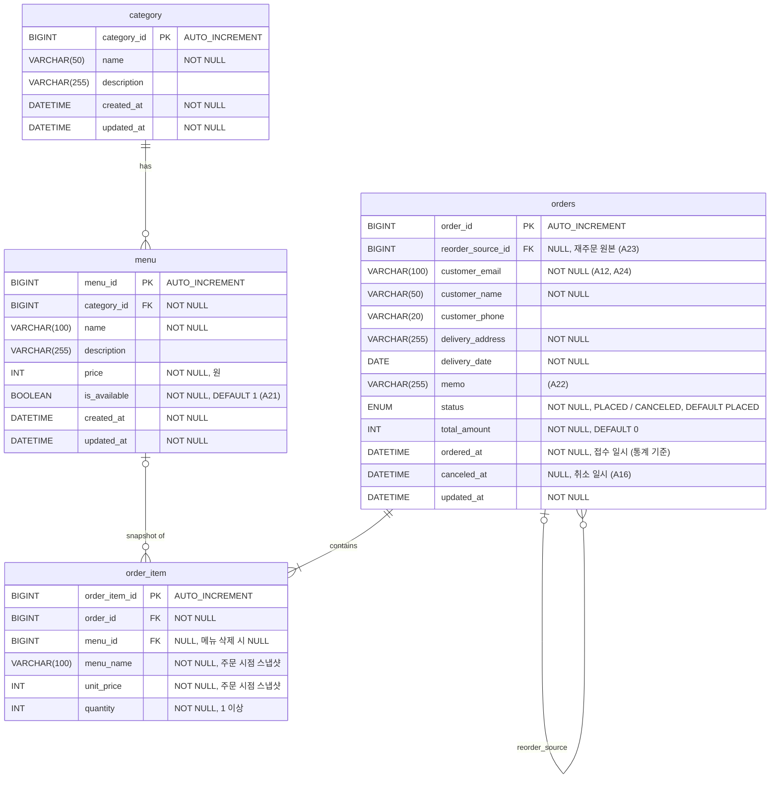

# ERD

`TODO.md`의 항목까지 반영된 **최종 구조** 기준입니다. 현재 코드와 다른 부분은 `TODO.md`를 참고하세요.

## 관계 / FK 정책

| FK | 참조 | ON DELETE | 이유 |
|---|---|---|---|
| `menu.category_id` | `category.category_id` | RESTRICT (기본) | 메뉴가 남아 있는 카테고리는 삭제 불가 |
| `order_item.order_id` | `orders.order_id` | CASCADE | 주문 항목은 주문에 종속. JPA에서도 `cascade = ALL, orphanRemoval = true` |
| `order_item.menu_id` | `menu.menu_id` | SET NULL | 메뉴가 삭제돼도 주문 내역은 스냅샷(`menu_name`, `unit_price`)으로 유지 |
| `orders.reorder_source_id` | `orders.order_id` | SET NULL | 원본 주문이 삭제돼도 재주문은 독립적으로 유지 |

## 엔티티 매핑 메모

| 항목 | 내용 |
|---|---|
| PK 생성 | 모든 엔티티 `IDENTITY` 전략. DB에 `AUTO_INCREMENT` 필요 |
| PK 필드명 | `xxxId` 규칙 (`categoryId`, `menuId`, `orderId`, `orderItemId`) |
| 시각 타입 | `DATETIME` → `Instant`, `DATE` → `LocalDate` |
| `created_at` / `ordered_at` | JPA Auditing `@CreatedDate`, `updatable = false` |
| `updated_at` | JPA Auditing `@LastModifiedDate`. DB에 `ON UPDATE CURRENT_TIMESTAMP`가 없으므로 애플리케이션이 채움 |
| `canceled_at` | Auditing이 아닌 취소 로직에서 `status`와 함께 설정 (도메인 메서드는 추후 작성, `TODO.md`) |
| `orders.status` | `@Enumerated(EnumType.STRING)`, `constant/OrderStatus` (`PLACED`, `CANCELED`) |
| `orders.total_amount` | `order_item.unit_price × quantity` 합계. 항목 추가 시 함께 갱신 (도메인 메서드는 추후 작성, `TODO.md`) |
| `order_item.menu_name` / `unit_price` | `OrderItem` 생성 시 `Menu`에서 복사. 이후 메뉴 변경과 무관 |
| 연관관계 주인 | `menu.category` → `Category.menus`(mappedBy), `order_item.order` → `Order.items`(mappedBy). `order_item.menu`, `orders.reorder_source`는 단방향 |
| fetch | 모든 `@ManyToOne`은 `LAZY`. 응답은 엔티티 대신 DTO(`record` + `from()`)로 변환 |
